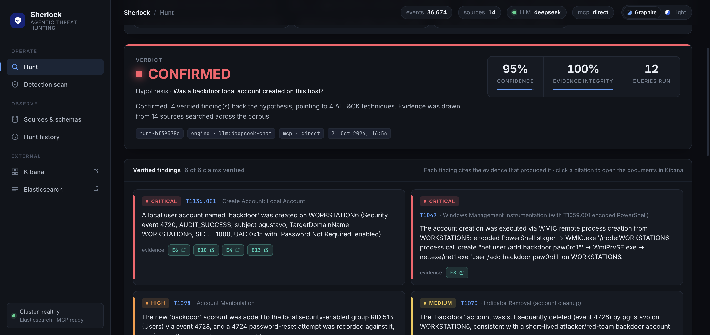
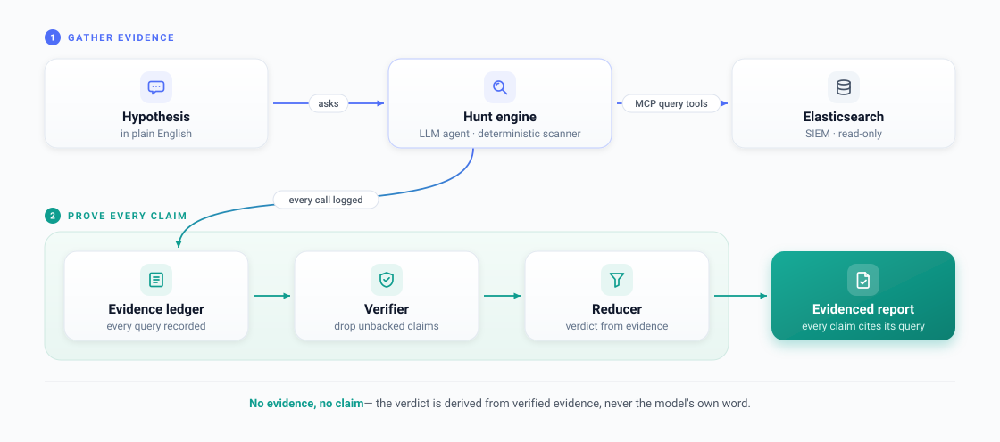

**English** · [中文](README.zh-CN.md)

# Sherlock — Agentic Threat Hunting on the ELK Stack

Sherlock is an **AI threat-hunting tool** that runs on your ELK (Elasticsearch) logs. You
ask a security question in plain English — e.g. *"was a backdoor account created on this
host?"* — and it searches the SIEM for you, reaches a verdict, and **backs every
conclusion with the exact query it actually ran** as evidence.

Its guiding rule is **no evidence, no claim**: any conclusion not backed by a query is
dropped before it reaches the report.



## Why it exists

Security teams drown in logs, and hunting an intrusion means hand-writing queries one
hypothesis at a time; point an LLM at the logs instead and it hallucinates — a fabricated
"intrusion" wastes a day, a missed one is a breach. Sherlock makes every conclusion
auditable back to the data: a verifier recomputes the verdict from only the evidence that
checks out, so the AI's verdict becomes trustworthy.

## Quick start

Needs Docker Desktop + [uv](https://docs.astral.sh/uv/).

```bash
make demo              # start ELK + download & ingest the public datasets
cp .env.example .env   # (optional) add an LLM key — the Scan engine needs none
make dashboard         # open http://localhost:8080
```

Type a hypothesis and **Run hunt**, or use **Detection scan** (deterministic, no key).
With no API key, everything still runs end to end on the deterministic engine.

## What it proves

On the public OTRF Security-Datasets — ~36,700 real events, 14 ATT&CK techniques across
7 tactics, DeepSeek:

| Metric | Result |
|---|---|
| Attacks detected (recall) | **14 / 14 — 100%** |
| False-positive rate | **0%** |
| Accuracy (20 labelled hypotheses) | **100%** |
| LLM claims caught as unsupported | **6%** (0 reach the report) |
| Same hypothesis, run twice | **same verdict every time (4/4)** |
| Deterministic scanner coverage | **15 / 15** probed techniques |

Raw runs: [`docs/benchmark_results_deepseek.md`](docs/benchmark_results_deepseek.md),
[`docs/experiment_results.md`](docs/experiment_results.md),
[`docs/ablation_results.md`](docs/ablation_results.md).

## How it works



Logs enter via **pull / push / stream**, and an **auto-schema agent** builds a parser for
each new source. The **hunt engine** (LLM agent or deterministic scanner) can touch data
**only** through a bounded **MCP tool surface**, and every call is recorded in an
**evidence ledger**. A **verifier** keeps only findings backed by a successful query; a
**reducer** derives the verdict from that verified evidence. The **dashboard** streams it
all live. Full detail: [`docs/sherlock-spec.md`](docs/sherlock-spec.md).

## Mapped to the brief

| Requirement | Where |
|---|---|
| Ingest via **pull, push, stream** | `ingestion/pull.py`, `POST /api/ingest/push`, `ingestion/stream.py` |
| **Agentic ingestion** — point at a source, agents do the rest | `ingestion/auto_schema.py` |
| **Auto schema**: inspect → match → else create, validate, register | `ingestion/auto_schema.py`, `ingestion/schema_registry.py` |
| **≥3 log types** (14 public ATT&CK datasets) | `datasets/mordor_import.py` |
| **MCP server** exposing search / aggregation | `mcp_server/server.py`, `mcp_server/tools.py` |
| **Agentic hunt**: plan → query → test → evidenced report | `hunt_engine/` |
| **Completeness/accuracy + anti-hallucination** | `hunt_engine/evidence_ledger.py`, `hunt_engine/verifier.py` |
| **Same hunt twice + compare** | `experiment/run_twice.py` |

## More

- **LLM providers** — 13+ back-ends behind one interface (DeepSeek, OpenAI, Anthropic,
  Gemini, Groq, OpenRouter, local Ollama…). See which are ready with `make providers`;
  adapters live in `common/providers.py`.
- **Seven-SIEM interoperability** — one canonical `n_*` field set so a single query fires
  across CEF / LEEF / CIM / ECS / OCSF / ASIM / UDM, proven by
  `uv run pytest tests/test_core.py -k normalise_all_seven_agree`.
- **Datasets & provenance** — the 14-capture manifest with each ATT&CK id lives in
  `datasets/mordor_import.py`.
- **Architecture spec** — [`docs/sherlock-spec.md`](docs/sherlock-spec.md).
- **CLI** — `uv run python -m cli hunt "…"` · `… status` · `… schemas`.
